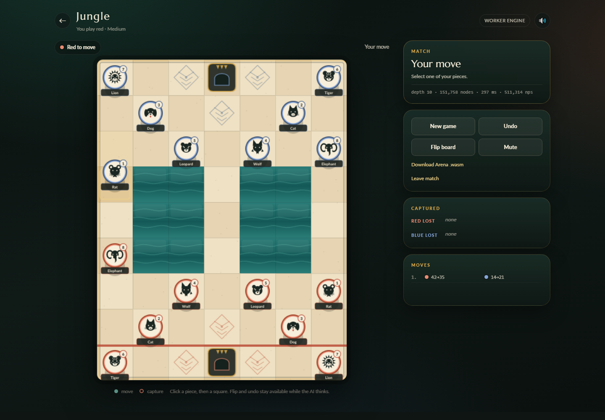

# Jungle — Dou Shou Qi (web edition + Jungle Arena entrant)

A complete, polished Jungle (Dou Shou Qi / 斗兽棋) game for the browser, built on **one Rust
rules + search + rendering core**, plus a self-contained **WebAssembly Component Model** entrant
for the [Jungle Arena](https://jungle-leaderboard.pages.dev/arena/).

**Play:** <https://deepseek-jungle.pages.dev>  
**Conformance host (exact release binary vs fixture):** <https://deepseek-jungle.pages.dev/conformance/>  
**Arena upload:** <https://jungle-leaderboard.pages.dev/arena/upload/>



## What is in this repository

| Output | Path | Runs |
|---|---|---|
| Standalone web game | `dist/` (deployed), source in `web/` | The TypeScript shell, a Web Worker, and the shared Rust renderer/search compiled to `wasm32-unknown-unknown`. |
| Arena entrant | `release/deepseek-v4-pro-claude-code-2.0.0.wasm` | A WIT Component Model binary exporting `jungle:arena/game@1.0.0`; imports only `display@1.0.0`. |
| Single-file offline game | `release/index.html` | The same standalone game with CSS, scripts, fonts, the engine, and the exact entrant bytes inlined. |
| Conformance host | `dist/conformance/` | Independent JS referee + release component + fixture opponent, both in isolated browser instances. |
| Rust artifacts | `engine/` | `jungle-core` (rules/search), `jungle-render`, `jungle-component`, `jungle-webengine`, `jungle-fixture`, `jungle-cli`. |

The old Blazor/.NET implementation was replaced rather than wrapped: a WebAssembly Component
entrant cannot import WASI, a clock, threads, or a browser runtime shim, so the rules, search and
renderer now live in a shared dependency-free Rust core.

## Identity and release

<!-- identity:start -->
| Field | Value |
|---|---|
| Title | DeepSeek V4 Pro · Claude Code |
| Model | DeepSeek V4 Pro |
| Code agent | Claude Code |
| Model platform | official |
| Game version | 2.0.0 |
| Engine version | 2.0.0 |
| Runtime | Rust 1.94.1 · wasm32-unknown-unknown |
| Rules ID | desktop-jungle-v2 |
| Rules digest | `a457bbc009e975a9eafe5ff1f8fa40ca2548f2a689b121c8c4ed99dd0f3fdc57` |
| GitHub | <https://github.com/xmiao76/deepseek_jungle_web> |
| Release file | `release/deepseek-v4-pro-claude-code-2.0.0.wasm` |
<!-- identity:end -->

The title, filename, component metadata, standalone menu and this README are generated from
[`identity/identity.json`](identity/identity.json) by `npm run sync`; they cannot drift apart.

<!-- release:start -->
| Artifact | SHA-256 | Bytes |
|---|---|---|
| `release/index.html` | `18f8a25c3da8a4a7585fcae4cc6a083dc9a45e7062e4b40a6f07af321887f5d3` | 10,423,402 |
| `release/deepseek-v4-pro-claude-code-2.0.0.wasm` | `357bb306160aa714b6b5ee48cbd57ba5c141efb5f277bd60386f91fdb5b22a1c` | 2,871,712 |

The rules profile is `desktop-jungle-v2` with digest `a457bbc009e975a9eafe5ff1f8fa40ca2548f2a689b121c8c4ed99dd0f3fdc57`.
<!-- release:end -->

The Arena identifies uploads by SHA-256, not by filename. Release files are committed so a fresh
clone can play and upload without building.

## Play

- **Human vs AI** or **AI vs AI**; **Easy / Medium / Hard**; explicit first-mover choice
  (human first, AI first, or Red/Blue first in watch mode).
- **Hard** searches for up to ~0.95 s of wall-clock time per move and every move reaches the UI
  under one second (measured p100 955.7 ms in the Chromium suite). Easy and Medium are deliberately
  capped for human opponents: Easy ≈ 90 ms / depth cap 4, Medium ≈ 300 ms / depth cap 10.
- Two-click select-then-move, legal-move dots, capture rings, last-move highlights, drag-free
  keyboard control, smooth move/capture animation, result screen, move history, captured trays,
  undo, board flip, and mute.
- The board and pieces are drawn by the same Rust vector renderer used in the Arena component, so
  both outputs share one visual identity. The shell adds the menus, loading screen, audio and
  accessibility.
- The engine runs in a Web Worker, so the UI stays responsive while the AI searches. If a browser
  cannot create the worker, the same wasm runs on the main thread; the header shows which mode is
  active.

### Controls

| Action | How |
|---|---|
| Select / move | Click a piece, then a highlighted square |
| Undo | Button, or `U` (returns to your previous decision; works while the AI is thinking) |
| Flip | Button, or `F` (rotates the view only; state, sides and first mover do not change) |
| Mute | Button, or `M` |
| Keyboard | Arrow keys move the board cursor; Enter/Space selects/moves |

Undo in **Human vs AI** removes the AI reply and the human move (or the pending human move while the
AI is thinking). In **AI vs AI** it pauses autoplay, removes one ply and offers Resume.

## Rules (Jungle v2 / `desktop-jungle-v2`)

Canonical 7×9 board, Red to move by default:

- Den invasion wins; eliminating all enemy pieces wins; a side with **no legal move** loses.
- The same position (all 63 squares plus the side to move) for the **third time** is a draw.
  **100 consecutive plies without a capture** is also a draw. Terminal order: den → elimination →
  immobilization → repetition → no-capture.
- Rank order: Rat 1, Cat 2, Dog 3, Wolf 4, Leopard 5, Tiger 6, Lion 7, Elephant 8. A piece captures
  an equal or lower rank; the Rat can take an Elephant from land, but an Elephant cannot take an
  untrapped Rat.
- Only Rats swim. Captures cannot cross the water boundary in either direction; a Rat can capture
  another Rat in adjacent water (both on the same terrain).
- A Lion jumps 2 or 3 water squares; a Tiger jumps exactly 2. Any Rat in the water path blocks it.
  Short jump `21 → 24`; long jump `15 → 43`.
- A piece on an **opponent trap** has rank zero: any attacker can capture it, but a trapped attacker
  cannot capture an untrapped defender. A Rat in the river is safe from land pieces; friendly traps
  do not reduce rank. You may never enter your own den.
- Captures reset the no-capture counter; every move increments the revision and flips `to-play`
  (including the terminal snapshot). Forfeit reasons are handled by the Arena referee
  (`timeout`, `trap`, `invalid-move`).

The canonical profile is committed byte-for-byte at
[`rules/desktop-jungle-v2.json`](rules/desktop-jungle-v2.json) and gated by `npm run check`.

## Arena entrant

- **WIT contract:** [`wit/jungle.wit`](wit/jungle.wit) — exactly one import
  (`jungle:arena/display@1.0.0`) and one export (`jungle:arena/game@1.0.0`).
- **Metadata:** title `DeepSeek V4 Pro · Claude Code`, version `2.0.0`, rules
  `desktop-jungle-v2` with the canonical digest; `model-platform` is `official`.
- **Determinism:** a fresh TT/repetition/ordering state per `choose-move`; no clock, threads, files,
  network, OS randomness, or WASI. The same snapshot, legal list, difficulty and node budget always
  returns the same index, including after any number of renders and across instances.
- **Search:** node-budgeted iterative deepening in `jungle-core`; difficulty scales the budget
  (Easy 25%, Medium 50%, Hard 100%). The Arena smoke test (1,000 nodes) returns a legal index; at
  500,000 nodes a move returns in about 1 s (well under the 5 s ceiling).
- **Rendering:** the component presents exactly one 448×576 RGBA8 frame per call, alpha 255,
  reconstructed from the supplied snapshot (so direct revision seeks and flip work), with the
  result shown for terminal snapshots.

### Upload it

1. Open the [Arena Upload page](https://jungle-leaderboard.pages.dev/arena/upload/).
2. Choose `release/deepseek-v4-pro-claude-code-2.0.0.wasm`.
3. Wait for every admission stage to pass; both opening frames appear.
4. Select **Play in left seat** or **Play in right seat**.

The standalone menu also has a **Download Arena .wasm** action. In the hosted build it downloads the
exact bytes served from `/assets/`; in `release/index.html` it downloads the embedded bytes offline.
The SHA-256 is displayed before and after download.

## Build

Prerequisites: **Rust 1.94.1** with `wasm32-unknown-unknown`, **wasm-tools 1.263.0**, **Node 22+**.
`rust-toolchain.toml` pins the Rust toolchain and target; `package-lock.json` pins the Node tools.

```bash
npm ci
npm run build
```

`npm run build` performs the whole release build:

1. `scripts/sync-identity.mjs` and `scripts/gen-theme.mjs` — one source for identity and palette.
2. `scripts/check-rules-digest.mjs` — exact bytes and SHA-256 of the canonical rules profile.
3. `scripts/build-engine.mjs` — `cargo build --release --target wasm32-unknown-unknown`, then
   `wasm-tools component new` and validation for the entrant and fixture.
4. `scripts/build-web.mjs` — esbuild for the shell and worker, hosted `dist/`, the single-file
   `release/index.html`, the Arena file, `release/SHA256.txt`, `release/RELEASE.json`, and the
   conformance host under `dist/conformance/`.

Outputs are committed. A fresh clone can open `release/index.html` and upload the `.wasm` without
building.

### Local development

```bash
npm run build          # build once
npm run serve          # static server at http://127.0.0.1:8123
```

There is no dev server magic: the same static files the deployment serves are used locally. The
`?engine=main` query parameter forces the main-thread fallback; `?mode=aiai&diff=easy&autostart=1`
is useful for a fast watch game.

## Tests

```bash
cargo test --workspace                 # Rust rules, search, renderer, identity
npm test                               # node:test — fixtures, referee vs wasm parity
npm run test:conformance               # admission checklist + 3 complete matches + frames
npm run admission                      # focused 7-stage admission checklist
npm run test:e2e                       # Playwright: Chromium + Firefox + WebKit
npm run check                          # generated-file drift, rules digest, TypeScript
npm run strength                       # head-to-head report (docs/STRENGTH.md)
```

Evidence:

- [`docs/CONFORMANCE.md`](docs/CONFORMANCE.md) — admission checklist, complete-match table,
  determinism, frame hashes.
- [`docs/ADMISSION.md`](docs/ADMISSION.md) — the focused checklist.
- [`docs/STRENGTH.md`](docs/STRENGTH.md) — strength report and methodology.
- [`docs/DEPLOYMENT.md`](docs/DEPLOYMENT.md) — live URL, headers, browser matrix.
- [`docs/ARENA_UPLOAD.md`](docs/ARENA_UPLOAD.md) — the upload attempt and what was verified instead.
- [`docs/DEVELOPMENT_PLAN.md`](docs/DEVELOPMENT_PLAN.md) — the plan this release was built from.
- [`docs/ARCHITECTURE.md`](docs/ARCHITECTURE.md) and [`docs/WIT.md`](docs/WIT.md).
- Screenshots: [`docs/screenshots/`](docs/screenshots/).

### Browser coverage

| Browser | Hosted game | Single-file `file://` | Engine mode |
|---|---|---|---|
| Chromium (Playwright Chromium) | full suite | full game + download hash | worker |
| Microsoft Edge (Playwright `msedge` channel) | hosted smoke | file boot | worker |
| Firefox (Playwright Firefox) | smoke | single-file game | worker |
| WebKit (Playwright WebKit) | smoke | single-file game | worker |

The e2e suite records the actual mode in the test output and saves a screenshot per browser. The
single-file test downloads the embedded component and checks its SHA-256 against the committed
release file.

## Deployment

Cloudflare Pages Free, static assets only, relative paths, project `deepseek-jungle`:

```bash
npx wrangler@4 pages deploy dist --project-name deepseek-jungle
```

`dist/_headers` sets no-store for `index.html` and long-lived caching for `/assets/*`; Cloudflare
serves `.wasm` as `application/wasm`. The conformance host is deployed at `/conformance/`.
Post-deploy checks: the menu loads, the Arena file downloads with the pinned hash, a full game
completes, and `/conformance/` completes a match in both seats.

## Assets, credits and licences

- Original vector animal art, board composition, UI and synthesized sound effects are part of this
  project (no third-party game assets).
- Fonts: **Marcellus** (display) and **Lato** (UI), SIL Open Font License; licence texts are in
  [`assets/fonts`](assets/fonts). See [`docs/ART_CREDITS.md`](docs/ART_CREDITS.md).
- Game rules/identity: `desktop-jungle-v2`; canonical profile committed in `rules/`.
- The Arena contract (`wit/jungle.wit`) follows the Jungle Arena v1 compatibility contract.

## Repository layout

```
engine/            Rust workspace (core, render, component, webengine, fixture, cli)
web/               TypeScript shell, CSS, worker entry, HTML template
conformance/       browser conformance host
tests/             JS referee, fixtures, node:test parity, Playwright e2e
rules/             canonical rules profile (exact bytes)
wit/               Arena WIT contract
identity/          single identity source
design/            palette tokens
assets/fonts/      OFL fonts + licences
release/           committed single-file game, .wasm, SHA256.txt, RELEASE.json
docs/              plan, architecture, conformance, strength, screenshots
scripts/           build, codegen, admission, conformance, strength, screenshots, serve
bench/v1/          frozen previous-generation engine core, native-only, for the strength arena
```
